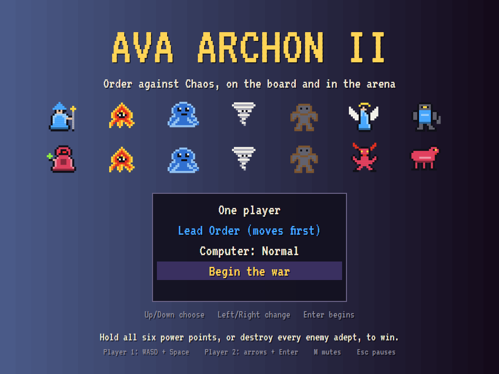
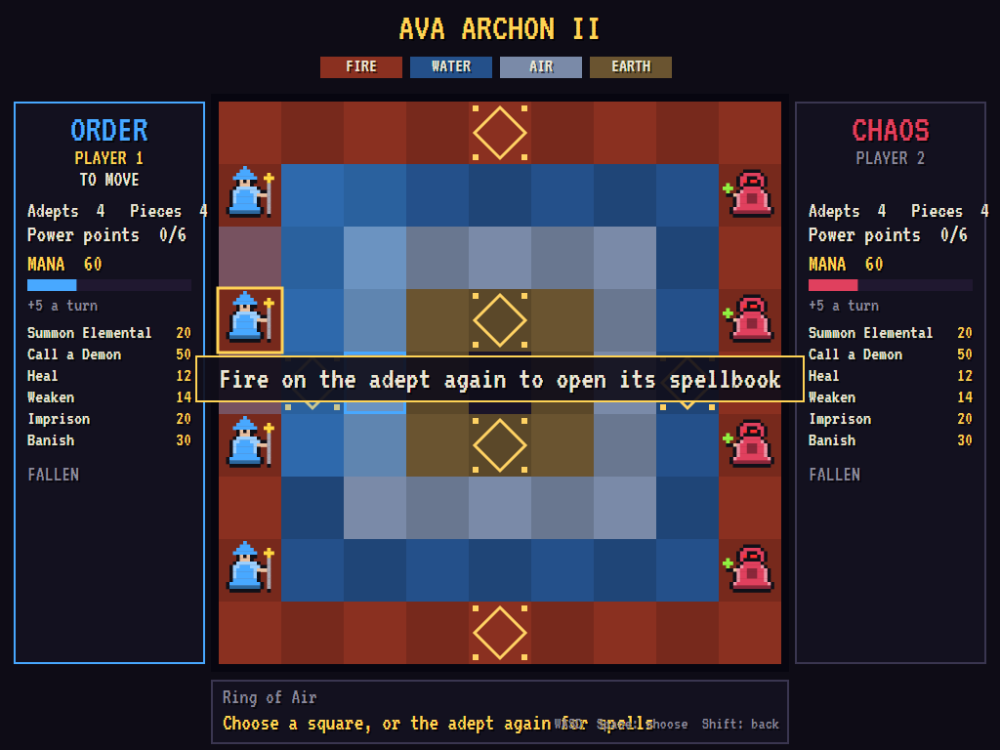
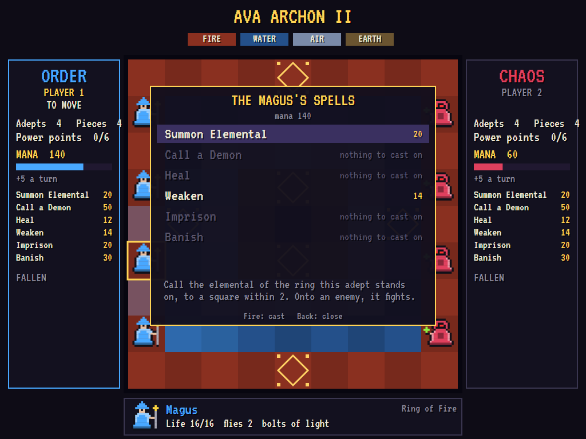
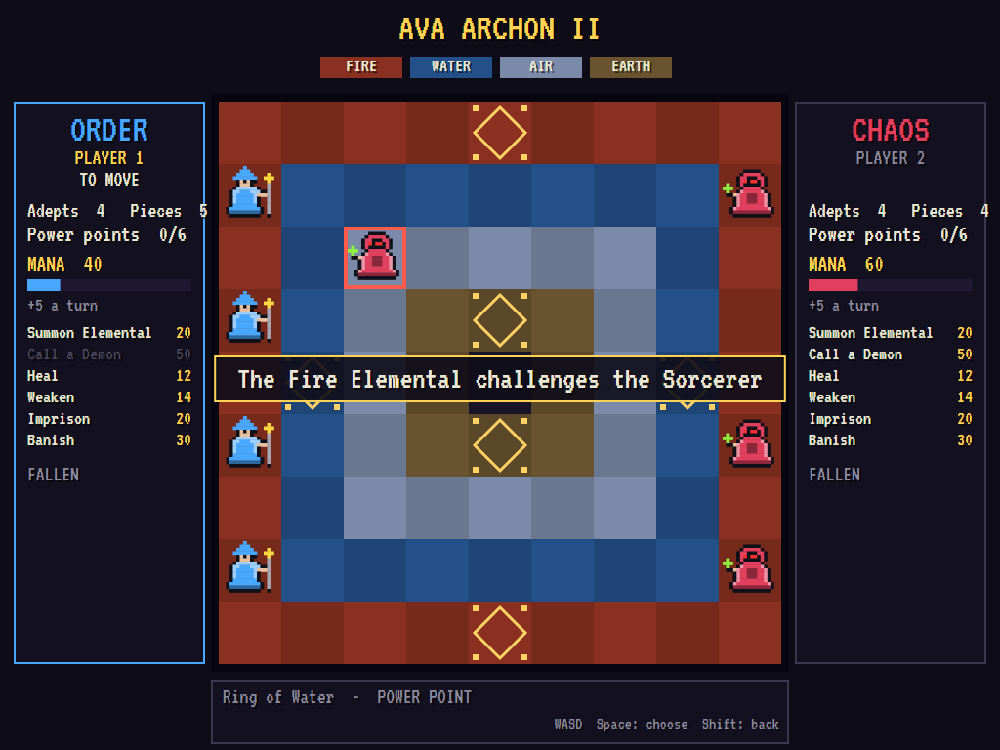
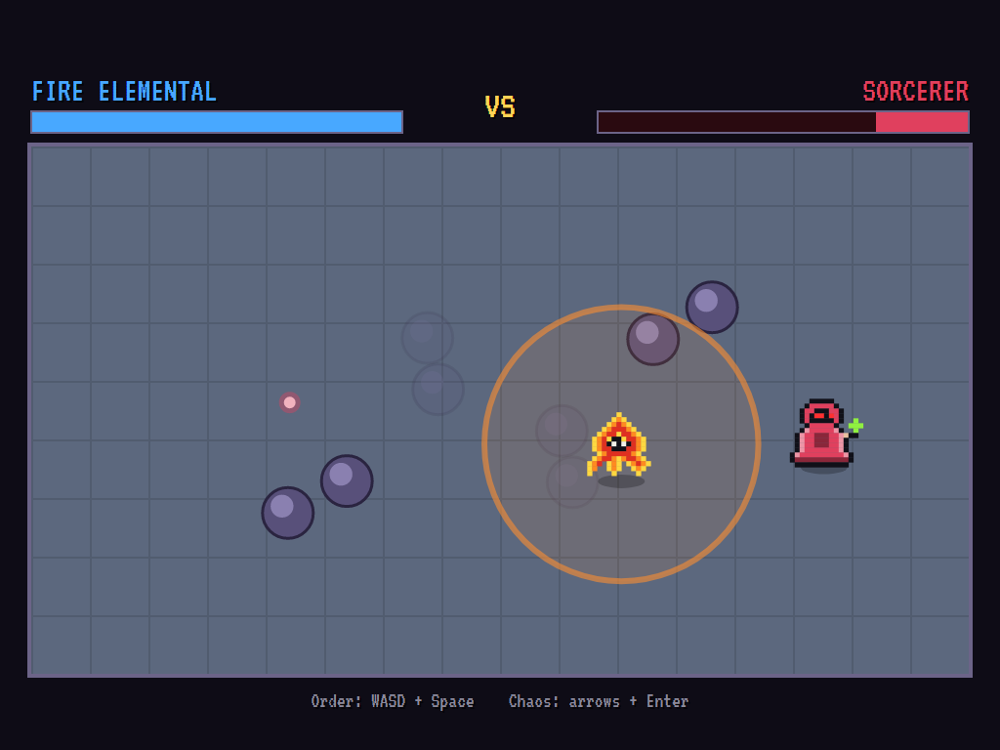
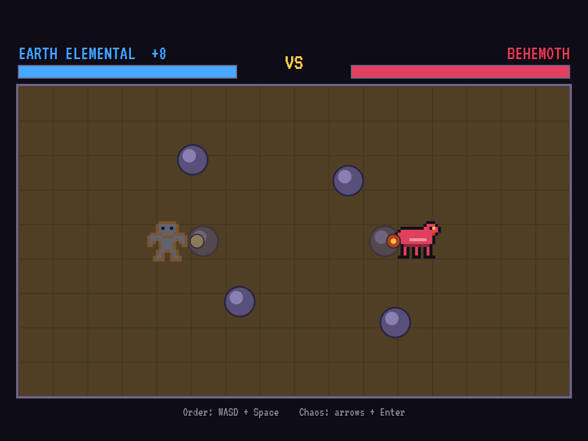
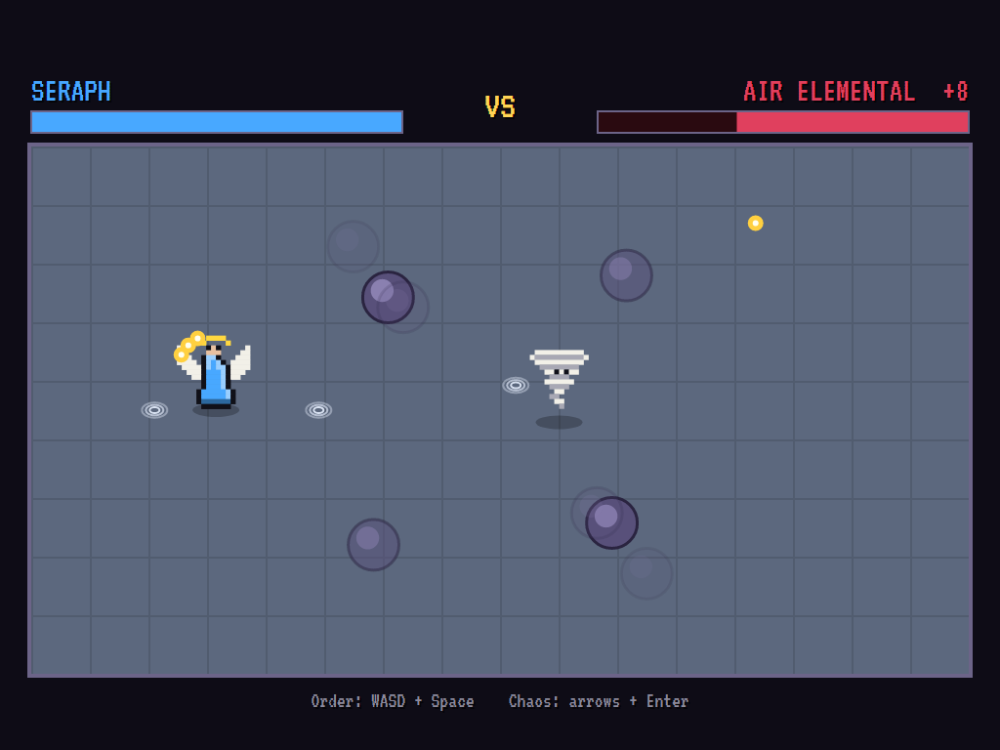
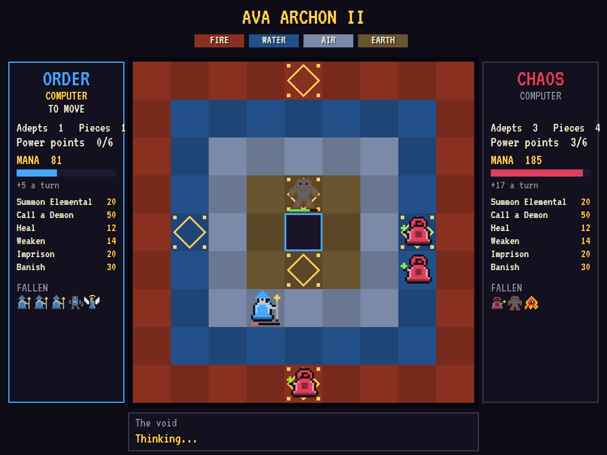
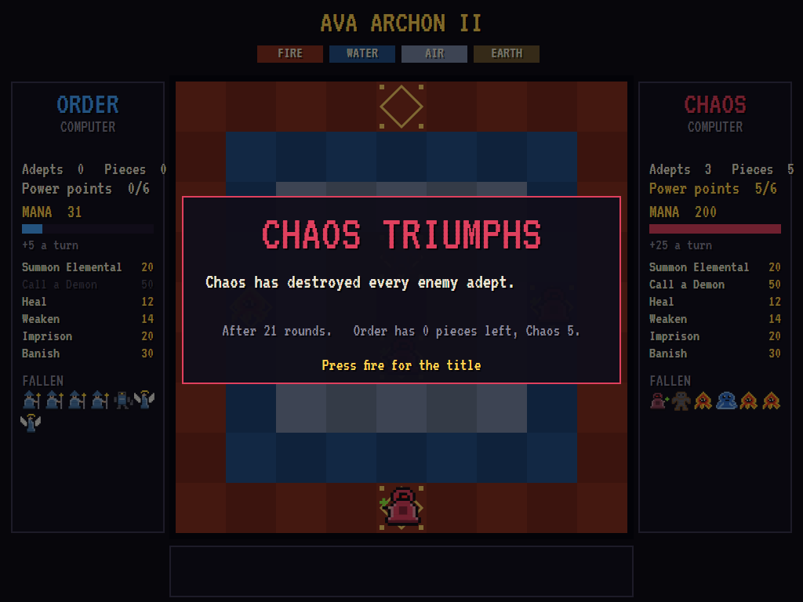

# AVA Archon II

[](https://github.com/Harlock123/AVAArchon2/actions/workflows/build.yml)

A strategy game of spellcasting and real-time battles, in the style of Free Fall Associates' 1984 sequel
**Archon II: Adept**. It's built with .NET 10 and Avalonia UI, on the engine of
[AVAArchon](https://github.com/Harlock123/AVAArchon). **Order** and **Chaos** each send four adepts onto a
board of four elemental rings. The adepts hardly fight. They call: elementals out of the ring they stand on,
and demons from afar, paid for in mana. When pieces meet, the board gives way to an arena, and the two fight
it out in real time.

Play against the computer at one of three skills, or against a friend on the same keyboard. The pieces,
spells and wording are original: this is the *style* of the classic, not its contents.

## How the war is fought

1. **The board**: four rings round the void at its heart. **Fire** is the outer ring, then **Water**,
   **Air** and **Earth**.
2. **The adepts**: four a side, starting on their home edges. Each moves two squares and casts. Lose all
   four and the war is lost.
3. **Mana** pays for every spell. Each side starts with 60. It gains 5 at the end of each of its turns, and
   4 more for each power point it holds, up to 200.
4. **The spells** (any adept may cast any of them):
   - **Summon Elemental** (20): call the elemental of the ring the adept stands on, to a square within two.
     Onto an enemy, it fights for the square at once. Elementals stay on the board as pieces of their own.
   - **Call a Demon** (50): set one of your two demons on any enemy elemental or demon, anywhere on the
     board. Adepts are shielded from demons.
   - **Heal** (12): heal a badly hurt piece (more than half its life gone) of every wound.
   - **Weaken** (14): take half the life from an enemy that isn't already weakened.
   - **Imprison** (20): hold an enemy elemental or demon still for three of its turns.
   - **Banish** (30): send an enemy elemental or demon back where it came from.
5. **The elementals**: each fights with 8 extra life on its own ring.
   - **Fire** flies 4 and burns all around it.
   - **Water** walks 3, slow and heavy, and crushes.
   - **Air** flies 5: quick, with whirlwinds.
   - **Earth** walks 2, very tough, and throws boulders.
6. **The demons**: Order's **Seraph** (holy fire, three at a time) and **Colossus** (hurled stone); Chaos's
   **Fiend** (hellfire) and **Behemoth** (brimstone). Each side's pair matches the other's in strength.
   The flier answers a call against a lighter foe, the heavy one against a tough one.
7. **The arena**: each champion moves and aims in eight directions and fires. Some strike close, some
   shoot, and the fire elemental bursts all around. The arena's pillars breathe: solid, they block
   walkers and missiles; fading, they let everything through. The floor is the element of the square
   fought over.
8. **The power points**: six of them, glowing gold, two on each of the rings of Fire, Water and Earth. A
   piece on one heals fast, spells can't touch it, an adept on one fights stronger, and each one held adds
   to its side's mana.

**Victory** goes to whoever holds all six power points, or destroys every enemy adept. If 150 turns pass
without a fight, the war ends in a truce.

## Features

- **Measured odds**: the tests have the computer fight every pairing of Order piece against Chaos piece,
  and the computer general judges each fight by those odds and the squares' strength.
- **A computer general**: it calls elementals onto power points and against foes it should beat, sets
  demons on enemy creatures worth the mana, heals the badly hurt, weakens, imprisons and banishes. It takes
  and holds power points, and pulls threatened pieces back.
- **A computer fighter**: in the arena it lines up shots, keeps its distance or closes in as its weapon
  needs, and sidesteps missiles. Easy, Normal and Hard differ both on the board and in the arena.
- **Two players**: Order and Chaos each have their own keys (or gamepad).
- **Attract mode**: leave the title alone for 20 seconds and the computer plays both sides.
- **Any window size**: the screen scales to fit, letterboxed. **Ctrl+S** saves a screenshot.

## Screenshots

| The title | The board | The spellbook |
|:---------:|:---------:|:-------------:|
|  |  |  |
| Adepts, elementals and demons. | An adept picked up. | A Magus's spells, and their mana. |

| The challenge | A ring of fire | A demon |
|:-------------:|:--------------:|:-------:|
|  |  |  |
| An elemental called against a Sorcerer. | The fire elemental bursts. | Boulders against brimstone. |

| A seraph | The war goes on | Victory |
|:--------:|:---------------:|:-------:|
|  |  |  |
| Holy fire against whirlwinds. | Chaos holds three power points. | The last adept falls. |

The tests make these screenshots by playing the game in a real (headless) window; see [Tests](#tests).

## Download and run

The [Releases page](https://github.com/Harlock123/AVAArchon2/releases/tag/latest) has ready-to-run builds
for Windows, macOS and Linux, on both Intel/AMD and ARM. **Latest build** is rebuilt on every push to
`main`. Each download is one self-contained executable, so there's no .NET to install.

| Platform | Archive |
|---|---|
| Windows | `AVAArchon2-win-x64.zip`, `AVAArchon2-win-x86.zip`, `AVAArchon2-win-arm64.zip` |
| macOS | `AVAArchon2-osx-arm64.tar.gz` (Apple silicon), `AVAArchon2-osx-x64.tar.gz` (Intel) |
| Linux | `AVAArchon2-linux-x64.tar.gz`, `AVAArchon2-linux-arm64.tar.gz`, `AVAArchon2-linux-arm.tar.gz` |

```bash
tar -xzf AVAArchon2-linux-x64.tar.gz     # or linux-arm64, linux-arm, osx-arm64, osx-x64
./AVAArchon2
```

On Windows, unzip the archive and run `AVAArchon2.exe`. On macOS, if Gatekeeper refuses to open it,
run `xattr -d com.apple.quarantine AVAArchon2` once. To play without sound, run it with `--no-audio`.

**Sound** comes through OpenAL Soft, which is built in for every platform. In a virtual machine the
game detects the VM and uses a larger audio buffer, so the sound doesn't break up.

**Gamepads** use SDL2, which is bundled for Windows, macOS and Intel/AMD Linux. ARM Linux builds need
SDL2 installed; without it, the keyboard still works:

```bash
sudo apt install libsdl2-dev            # Debian / Ubuntu / Raspberry Pi OS
sudo pacman -S --needed sdl2-compat     # Arch / Omarchy
```

## Controls

| | Player 1 (Order in a two-player game) | Player 2 (Chaos) |
|---|---|---|
| Move the cursor, or the champion | **W A S D** | **Arrow keys** |
| Fire: choose, cast, attack | **Space** / **Left Ctrl** / **Z** | **Enter** / **Right Ctrl** |
| Back: put a piece down, close the spellbook | **Left Shift** / **X** / **Q** | **Right Shift** / **Backspace** |
| Gamepad | the first: stick or D-pad, A to fire, B to go back | the second |

Playing alone, either set of keys works. To open an adept's spellbook, choose the adept, then choose it
again.

| Anywhere | |
|---|---|
| **Enter** on the title | Begin |
| **P** / **Esc** | Pause (Esc again for the title) |
| **M** / **F2** | Mute |
| **Ctrl+S** / **Cmd+S** | Save a screenshot to the Pictures folder |

## Tests

```bash
dotnet test AVAArchon2.slnx
```

The engine has no UI and runs in fixed 60 Hz steps, so a seed always plays the same game. The tests
check:

- **The board**: four adepts a side on their home edges, the rings of the elements and the six power
  points; an elemental strongest on its own ring and an adept on a power point; mana growing each turn,
  faster for each power point held; walkers going round pieces while fliers pass over.
- **Spells**: an adept summoning the elemental of its ring near it, and one summoned onto an enemy
  fighting for the square; a demon striking an elemental anywhere, but never an adept; heal, weaken,
  imprison and banish (and adepts never imprisoned); spells costing mana and never touching a power
  point.
- **Fights**: moving onto an enemy and the winner holding the square; blows landing only within reach,
  solid pillars stopping missiles, and the ring of fire rooting its maker; wounds healing, fastest on a
  power point.
- **Winning**: holding all six power points, and destroying every enemy adept.
- **The computer**: taking a fight it will win and shunning one it will lose; Hard beating Easy in the
  arena and over a whole war; whole wars played to a finish.
- **The machine**: the title sets up the game and idles into a demonstration; every piece has a picture
  and every sound a file; there are measured odds for every pairing.

The screenshot tests draw the real screen in a headless window. To refresh the README's pictures:

```bash
ARCHON_SHOTS=$PWD/Images dotnet test tests/AVAArchon2.Tests --filter ScreenshotTests
```

After changing any piece's numbers, measure the odds afresh (the computer judges fights by them):

```bash
ARCHON_ODDS=1 dotnet test tests/AVAArchon2.Tests --filter OddsTableTests.Measure
```

## Building

```bash
dotnet build AVAArchon2.slnx
dotnet run --project src/AVAArchon2
```

You'll need the .NET 10 SDK. `tools/make_sounds.py` makes the sounds and needs only standard-library
Python: `python3 tools/make_sounds.py` rewrites `src/AVAArchon2/Sounds`.

## Project structure

```
AVAArchon2/
├── AVAArchon2.slnx
├── src/AVAArchon2/
│   ├── Engine/
│   │   ├── Pieces.cs              # Adepts, elementals and demons: moves, life, weapons
│   │   ├── Board.cs               # The rings, power points, mana, moves, healing
│   │   ├── Arena.cs               # The real-time fight: fighters, missiles, breathing pillars
│   │   ├── Brain.cs               # The computer's hands in the arena
│   │   ├── Computer.cs            # The computer's general: moves and spells
│   │   ├── OddsTable.cs           # Measured odds of every pairing (generated by the tests)
│   │   ├── Spells.cs              # The adepts' six spells, their mana and whom they may touch
│   │   ├── GameEngine.cs          # States, the title, players and controls
│   │   ├── GameEngine.Turn.cs     # A turn: picking, moving, casting, fighting, winning
│   │   ├── InputHandler.cs, ControllerManager.cs  # Two players' keys and SDL2 gamepads
│   │   └── SoundManager.cs        # Effects and tunes through OpenAL
│   ├── Audio/                     # The OpenAL engine (from the author's AVABand)
│   ├── Views/                     # The board, the arena, the title, and the pictures
│   └── Sounds/                    # The synthesised effects and tunes
├── tests/AVAArchon2.Tests/        # Gameplay, odds and screenshot tests
├── tools/make_sounds.py
└── Images/                        # Screenshots
```

## About and licence

AVA Archon II © 2026 Lonnie Watson, under the [MIT License](LICENSE).

*Archon II: Adept* © 1984 Free Fall Associates and Electronic Arts. The name belongs to its current owner.
AVA Archon II is an independent, unofficial game in its style. Its pieces, spells, board, graphics,
sounds, tunes and code are its own, and nothing is taken from that game. No rights holder is affiliated
with or endorses it.
